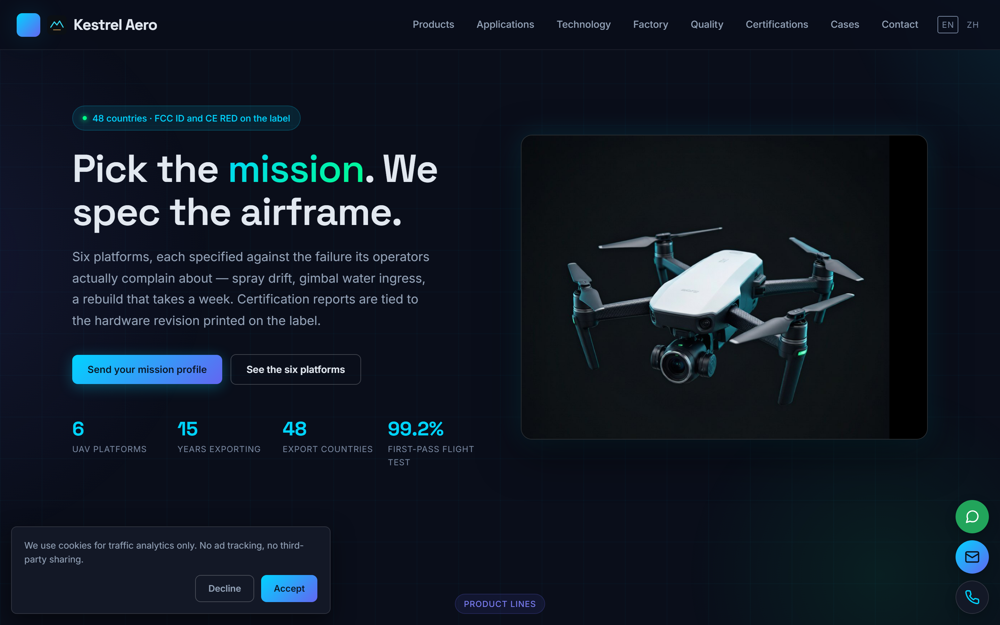
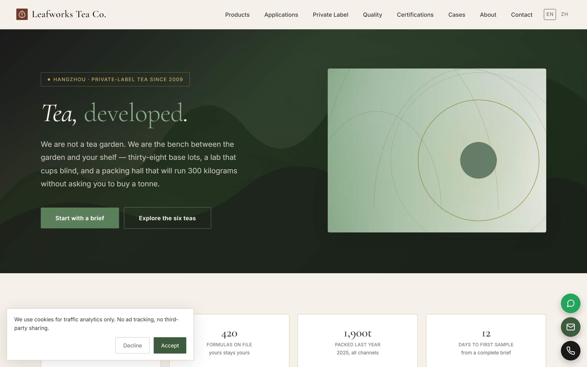
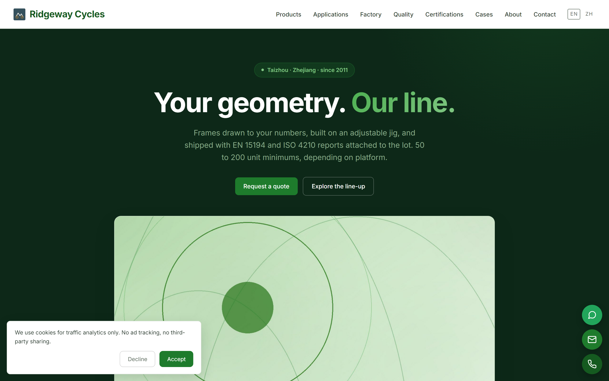
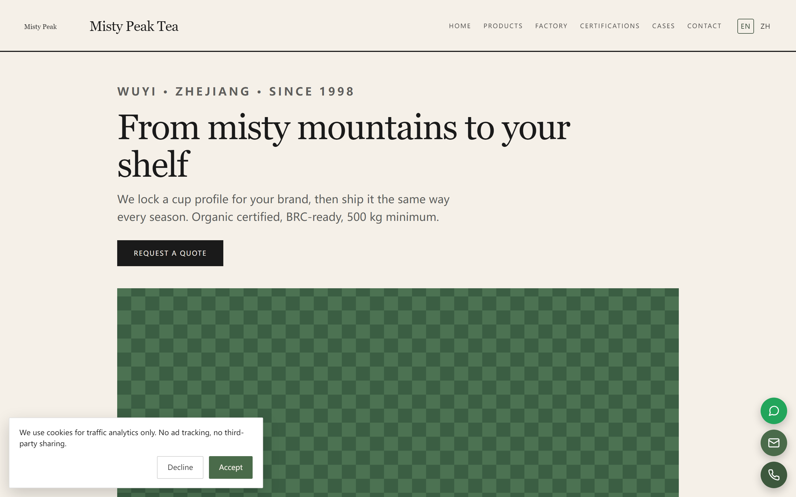

# TradeEngine — 外贸站交付引擎

> 把外贸站交付从 6 周压到 12 小时。输入客户资料，输出一个可上线、合规、多语言、能收询盘的外贸站。

TradeEngine 不是通用 CMS，而是一条**交付流水线**：Go 单二进制引擎 + 一套可执行的评分方法论（B1/B2）+ 九套预置皮肤 + 站点评测工具。配套的 A 系列文档把开发、性能、询盘、多语言、部署、安全、数据、维保九个环节的实战经验沉淀成了可复用知识。

## 仓库结构

```
├── LICENSE / NOTICE          MIT 许可 + 第三方资产说明（字体 OFL、AI 生成图）
├── docs/                     A 系列（开发实战 9 篇）+ B 系列（方法论 6 篇）+ 三站评分报告
├── docs/images/              演示站预览图
├── engine/                   Go 单二进制引擎（含 examples/zentea 演示站）
│   ├── clients/              三个虚构演示站：kestrel（无人机）/ leafworks（茶叶）/ ridgeway（自行车）
│   ├── internal/skins/       九套预置皮肤（CSS Zen Garden 模型，加皮肤零 Go 改动）
│   └── tools/gen_media.py    媒体生成管线（sources.yaml → 4:3 JPEG）
├── design/                   三份参考设计稿 + AI 生成配图
└── tools/audit-site/         站点评测工具：probe.py（确定性取证）+ score.py（计分校验器）
```

## 演示站预览

四套皮肤 × 四个虚构品牌，全部由引擎从 YAML 内容 + 预置皮肤一键构建：

| | |
| --- | --- |
|  |  |
| *kestrel 无人机 · aeronova（航宇暗色）* | *leafworks 茶叶 · zentea（茶韵东方）* |
|  |  |
| *ridgeway 自行车 · ecobike（骑行自然）* | *zentea 示例站 · zentea（茶韵东方）* |

## 引擎核心能力

- **区块化建站**：20 种区块类型，YAML 写内容 → 静态 HTML 多语言站点（hreflang / sitemap / llms.txt 自动生成）
- **询盘链路**：表单 → 蜜罐 + 限流 + Turnstile + 垃圾评分 → SQLite 落库 → SMTP/Webhook 双通道通知，V9 双向可验收
- **九套预置皮肤**：classic / editorial / tech / industrial / organic / minimal / ecobike / zentea / aeronova，`build --skin` 一键切换
- **合规内建**：Cookie 同意 + GA4、隐私/条款页起草、GPSR/Impressum 市场准入（`settings.compliance`）、SPF/DKIM/DMARC 构建期校验
- **机器可读产物**：`specs.csv`（每产品每语言）、`sku-list.csv`、`product-images.zip`、页面字节预算

## 快速开始

```bash
cd engine
go build -o engine.exe ./cmd/engine

./engine.exe new mysite --skin tech   # 生成 22 页站点骨架
cd mysite
../engine.exe build                   # 构建到 .build/public
../engine.exe serve --addr :8080 .    # 本地预览（询盘表单可直接提交测试）
../engine.exe inquiries               # 查看收到的询盘
```

14 个子命令见 `engine/README.md` 与 `B4外贸站交付引擎使用说明.md`。

## 站点评测（tools/audit-site）

按 B1 标准（50 条 × 2 分 + Veto 9 条 + Distinction 8 条）对任意网站做结构化评测：

```bash
python tools/audit-site/scripts/probe.py --url https://example.com --out reports/demo
python tools/audit-site/scripts/score.py --init reports/demo/verdict.json --site demo
# 逐条填写判定与证据后：
python tools/audit-site/scripts/score.py --verdict reports/demo/verdict.json
```

设计原则：**测的与判的分开**——确定性项（DNS 三记录/响应头/死链/爬取）由脚本实测，LLM 只做判断性裁定且必须引用证据，pass 无证据会被计分器拒算。

## 文档

| 文档 | 内容 |
| --- | --- |
| **docs/B1** 优秀外贸站的标准 | 评什么：50 条评分标准 + 9 条否决项 + 8 条加分项 |
| **docs/B2** 评分 SOP | 怎么评：110 分钟六步流程与判定口径 |
| **docs/B3** 引擎设计实现 | 怎么造：架构、数据模型、56 个规则码 |
| **docs/B4** 使用说明 | 怎么用：14 个命令逐个讲 |
| **docs/B5** 变更记录 | 改了什么：逐版本 |
| **docs/B6** 承接交付 SOP | 一单活怎么干：从立项到移交 |
| **docs/A1–A9** | 开发基础 / 选型 / 性能 / 询盘 / 多语言 / 部署 / 安全 / 数据复盘 / 维保合同 |

## 状态

当前版本 **v0.13.4**，15 包测试全绿，三演示站 Lighthouse 四项 100/97/100/100。详见 `engine/CHANGELOG.md`。

## 许可

MIT —— 见 [LICENSE](LICENSE)。字体与图片的第三方授权说明见 [NOTICE](NOTICE)。
